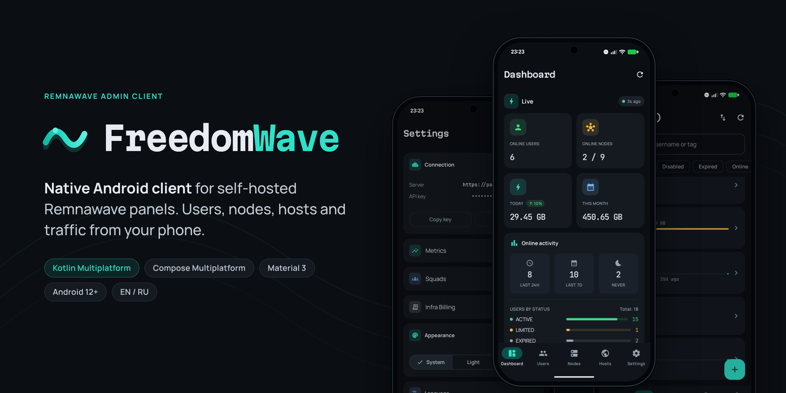
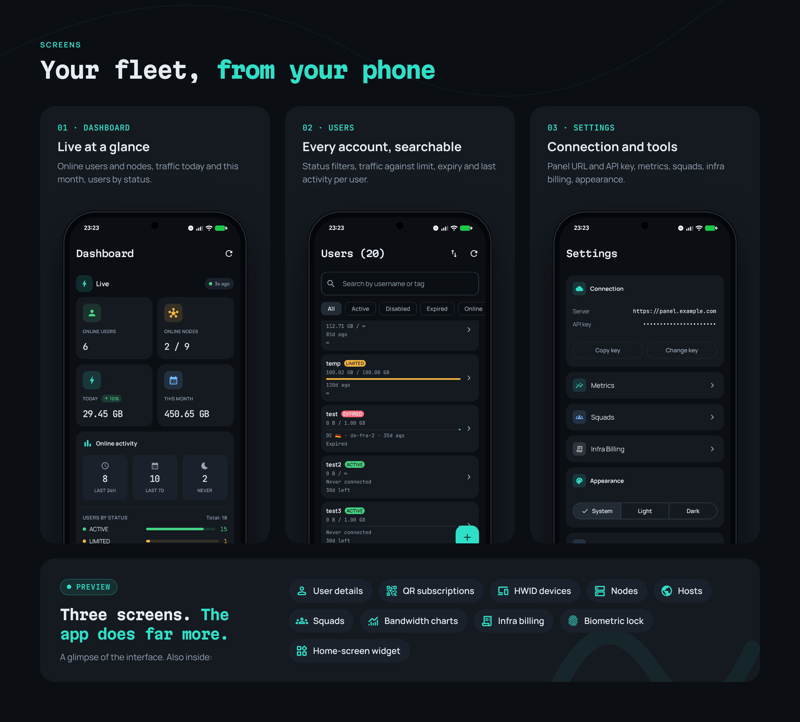
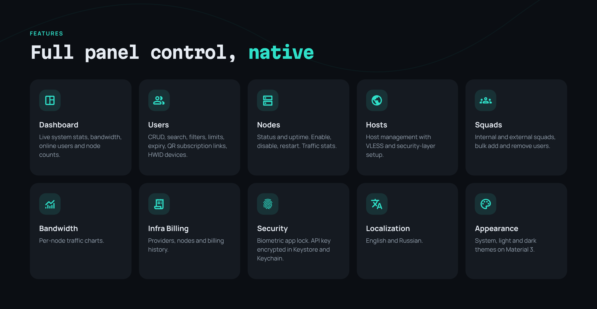

<p align="center">
  
</p>

<p align="center">
  <b>English</b> · <a href="README.ru.md">Русский</a>
</p>

**FreedomWave** is a native Android admin client for [Remnawave](https://remna.st), the self-hosted VPN/proxy panel. Manage users, nodes, hosts and traffic from your phone.

## Screens

<p align="center">
  
</p>

## Features

<p align="center">
  
</p>

<details>
<summary>Full list</summary>

- **Dashboard**: live system stats, bandwidth, online users and node counts
- **Users**: CRUD, search, filters, traffic limits, expiry, QR subscription links, HWID devices
- **Nodes**: status and uptime, enable, disable, restart, traffic stats
- **Hosts**: host management with VLESS and security-layer setup
- **Squads**: internal and external squads, bulk add and remove users
- **Bandwidth and metrics**: per-node traffic charts, realtime node metrics
- **Infra billing**: providers, nodes and billing history
- **Home-screen widget**
- **Security**: biometric app lock, API key encrypted with Android Keystore / iOS Keychain
- **Localization**: English and Russian
- **Appearance**: system, light and dark themes on Material 3

</details>

## Getting started

1. In your Remnawave panel, create an API token under **API Tokens**.
2. Open the app and enter your panel URL (e.g. `https://panel.example.com`) and the token.
3. The app checks the token and connects.

Requires Android 12 (API 31) or newer.

## Building

Needs JDK 17+ and Android SDK 36 (`minSdk 31`, `targetSdk 36`).

```bash
./gradlew :app:assembleDebug                         # debug APK
./gradlew :app:assembleRelease                       # release APK (R8 minified)
./gradlew :composeApp:testAndroidHostTest            # shared unit tests (JVM)
./gradlew :app:testDebugUnitTest                     # widget unit tests
./gradlew :app:connectedAndroidTest                  # instrumented tests (device/emulator)
./gradlew :app:lint                                  # lint
./gradlew :composeApp:linkDebugFrameworkIosArm64     # iOS framework (full Xcode required)
```

The release build is currently signed with the debug key. Set up your own `signingConfig` in `app/build.gradle.kts` before you distribute it.

## Technical details

### Architecture

The app is Kotlin Multiplatform with Compose Multiplatform UI. AGP 9+ doesn't allow `com.android.application` and `kotlin.multiplatform` in the same module, so the project has two:

| Module | Plugin | Contents |
|---|---|---|
| `:app` | `com.android.application` | Thin Android launcher: `MainActivity`, `FreedomWaveApplication`, manifest, resources, and the Glance home-screen widget |
| `:composeApp` | `com.android.kotlin.multiplatform.library` | All shared code: Compose UI, domain, data, DI. Builds an Android library and an iOS framework (`ComposeApp.framework`) |

Source sets in `:composeApp`:

| Source set | Contents |
|---|---|
| `commonMain` | All screens, view models, domain models, Ktor API layer, repositories, Koin modules |
| `androidMain` | Keystore `SecretStore`, biometric prompt, dynamic color, predictive back, DataStore path, locale |
| `iosMain` | Keychain `SecretStore`, Face ID / Touch ID (`LAContext`), DataStore via `NSFileManager`, back gesture, locale |
| `commonTest`, `androidHostTest` | Unit tests run on the JVM |

Inside `commonMain` the layers are:

```
data/api         Ktor client, DTOs, one service per Remnawave API area
data/repository  DTO → domain mapping, returns Result<T>
data/store       DataStore preferences, encrypted API key
domain/model     plain domain models
ui/feature       one package per screen: ViewModel + StateFlow UI state
di               Koin modules
```

Each screen has a `ViewModel` that exposes a `StateFlow<UiState>`. Navigation is a bottom navigation bar (Dashboard, Users, Nodes, Hosts, Settings) and each screen handles its own list/detail views, with no `navigation-compose`. Squads, bandwidth, metrics and infra billing open from Settings.

### Remnawave API

- Base URL is `https://<your-panel>/api`, taken from the URL you enter at login.
- Requests use `Authorization: Bearer <api token>`. The token comes from the panel's **API Tokens** page.
- Every request sends `x-remnawave-client-type: android`. Remnawave rejects API tokens from `browser` clients.
- The token is checked against `/api/system/stats` when you connect. Tokens don't expire in practice, so there is no refresh flow. A `401` clears the stored token and returns you to the login screen.
- Timeouts are 10 s to connect and 30 s per request.
- The app covers users (CRUD, enable/disable, reset traffic, revoke subscription), nodes (CRUD, enable/disable, restart, reorder), hosts, internal and external squads, HWID devices, subscriptions, bandwidth stats, node metrics, infra billing, config profiles and templates.

### Security

- On Android the API token is encrypted with AES/GCM using a non-exportable Android Keystore key, and only the ciphertext is kept in DataStore. On iOS it lives in the Keychain. Tokens saved in plaintext by older versions are migrated automatically.
- Biometric lock is optional and uses BiometricPrompt on Android and `LAContext` on iOS.
- The token and client-type header are sent only to your panel's host, never to third-party services such as the optional IP geolocation lookup, which uses a separate client.
- No analytics, ads or push services.

### Home-screen widget

The widget is built with Jetpack Glance and shows dashboard stats. WorkManager refreshes it every 45 minutes, and its refresh button updates it right away. Tapping the widget opens the app. It lives in `:app` under `org.freedomwave.widget`.

### iOS

All `iosMain` actuals are implemented and the shared code compiles to `ComposeApp.framework`. There is no Xcode app project yet, so iOS is a build target only for now.

### Stack

| Role | Library | Version |
|---|---|---|
| Language | Kotlin Multiplatform | 2.3.20 |
| UI | Compose Multiplatform, Material 3 | 1.10.3 |
| Build | Android Gradle Plugin | 9.2.1 |
| Networking | Ktor Client (OkHttp / Darwin engines) | 3.4.1 |
| Serialization | kotlinx.serialization | 1.9.0 |
| Coroutines | kotlinx.coroutines | 1.10.2 |
| DI | Koin | 4.1.0 |
| Storage | AndroidX DataStore (multiplatform) | 1.2.0 |
| ViewModel | JetBrains lifecycle-viewmodel-compose | 2.10.0 |
| Images | Coil 3 | 3.2.0 |
| QR codes | qrose | 1.0.1 |
| Date/time | kotlinx.datetime | 0.6.2 |
| Logging | Kermit | 2.1.0 |
| Drag to reorder | reorderable | 3.1.0 |
| Widget | Glance, WorkManager | 1.1.1, 2.10.0 |

All versions live in `gradle/libs.versions.toml`.

## License

[EUPL-1.2](LICENSE)
