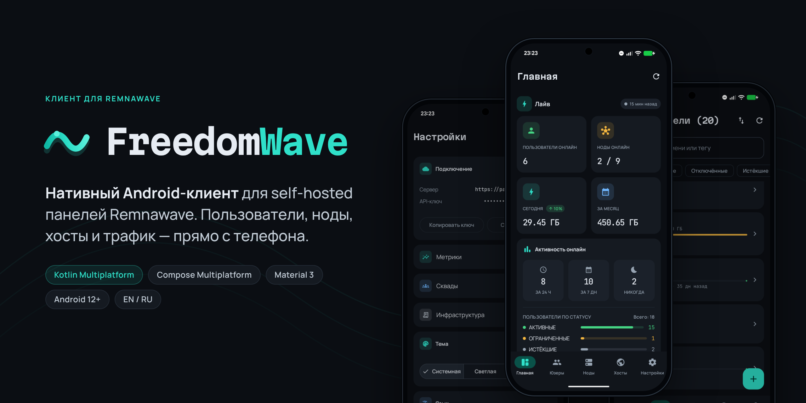
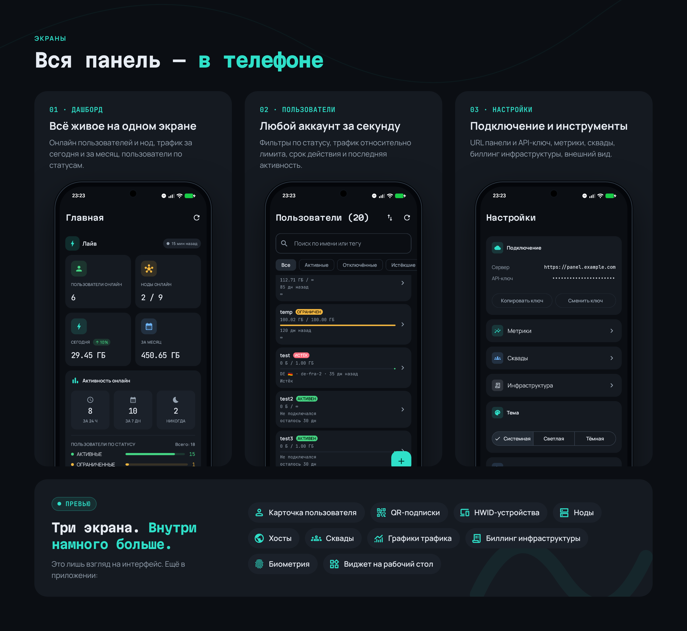
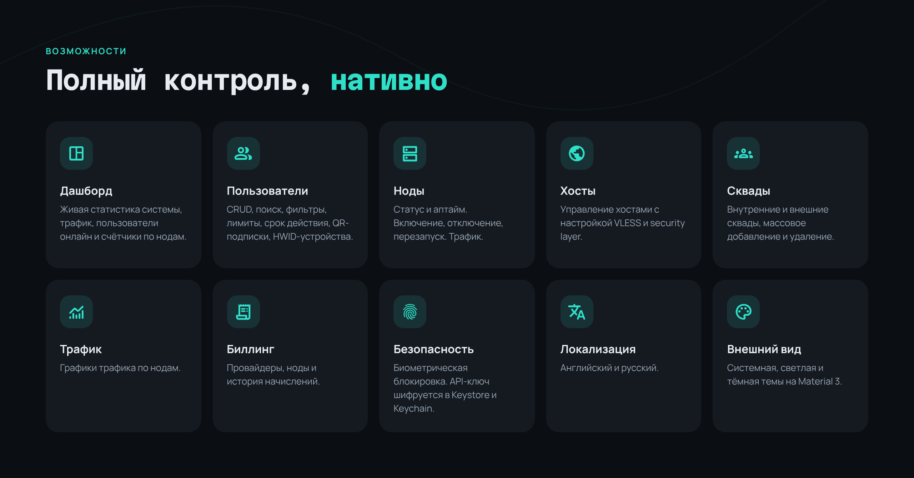

<p align="center">
  
</p>

<p align="center">
  <a href="README.md">English</a> · <b>Русский</b>
</p>

**FreedomWave** — нативный Android-клиент для администрирования [Remnawave](https://remna.st), self-hosted панели VPN/proxy. Пользователи, ноды, хосты и трафик — с телефона.

## Экраны

<p align="center">
  
</p>

## Возможности

<p align="center">
  
</p>

<details>
<summary>Полный список</summary>

- **Дашборд**: живая статистика системы, трафик, пользователи онлайн и счётчики по нодам
- **Пользователи**: CRUD, поиск, фильтры, лимиты трафика, срок действия, QR-подписки, HWID-устройства
- **Ноды**: статус и аптайм, включение, отключение, перезапуск, статистика трафика
- **Хосты**: управление хостами с настройкой VLESS и security layer
- **Сквады**: внутренние и внешние сквады, массовое добавление и удаление пользователей
- **Трафик и метрики**: графики трафика по нодам, метрики нод в реальном времени
- **Биллинг**: провайдеры, ноды и история начислений
- **Виджет на главный экран**
- **Безопасность**: биометрическая блокировка, API-ключ шифруется в Android Keystore / iOS Keychain
- **Локализация**: английский и русский
- **Внешний вид**: системная, светлая и тёмная темы на Material 3

</details>

## Начало работы

1. В панели Remnawave создайте API-токен в разделе **API Tokens**.
2. Откройте приложение и введите URL панели (например, `https://panel.example.com`) и токен.
3. Приложение проверит токен и подключится.

Требуется Android 12 (API 31) или новее.

## Сборка

Нужны JDK 17+ и Android SDK 36 (`minSdk 31`, `targetSdk 36`).

```bash
./gradlew :app:assembleDebug                         # debug APK
./gradlew :app:assembleRelease                       # release APK (минификация R8)
./gradlew :composeApp:testAndroidHostTest            # юнит-тесты общего кода (JVM)
./gradlew :app:testDebugUnitTest                     # юнит-тесты виджета
./gradlew :app:connectedAndroidTest                  # инструментальные тесты (устройство/эмулятор)
./gradlew :app:lint                                  # lint
./gradlew :composeApp:linkDebugFrameworkIosArm64     # iOS framework (нужен полный Xcode)
```

Release-сборка пока подписывается debug-ключом. Перед распространением настройте свой `signingConfig` в `app/build.gradle.kts`.

## Технические детали

### Архитектура

Приложение написано на Kotlin Multiplatform с UI на Compose Multiplatform. AGP 9+ не позволяет совмещать `com.android.application` и `kotlin.multiplatform` в одном модуле, поэтому модулей два:

| Модуль | Плагин | Содержимое |
|---|---|---|
| `:app` | `com.android.application` | Тонкий Android-лаунчер: `MainActivity`, `FreedomWaveApplication`, манифест, ресурсы и виджет на Glance |
| `:composeApp` | `com.android.kotlin.multiplatform.library` | Весь общий код: Compose UI, домен, данные, DI. Собирается в Android-библиотеку и iOS framework (`ComposeApp.framework`) |

Source sets в `:composeApp`:

| Source set | Содержимое |
|---|---|
| `commonMain` | Все экраны, ViewModel, доменные модели, API-слой на Ktor, репозитории, модули Koin |
| `androidMain` | `SecretStore` на Keystore, биометрия, динамические цвета, predictive back, путь DataStore, локаль |
| `iosMain` | `SecretStore` на Keychain, Face ID / Touch ID (`LAContext`), DataStore через `NSFileManager`, жест «назад», локаль |
| `commonTest`, `androidHostTest` | Юнит-тесты, запускаются на JVM |

Слои внутри `commonMain`:

```
data/api         Ktor-клиент, DTO, по сервису на каждый раздел API Remnawave
data/repository  маппинг DTO → домен, возвращает Result<T>
data/store       настройки в DataStore, зашифрованный API-ключ
domain/model     доменные модели
ui/feature       по пакету на экран: ViewModel + UI-состояние в StateFlow
di               модули Koin
```

У каждого экрана есть `ViewModel` со `StateFlow<UiState>`. Навигация — нижняя панель (Дашборд, Пользователи, Ноды, Хосты, Настройки), а список и детали каждый экран переключает сам, без `navigation-compose`. Сквады, трафик, метрики и биллинг открываются из настроек.

### Remnawave API

- Базовый URL — `https://<ваша-панель>/api`, из адреса, введённого при входе.
- Запросы идут с `Authorization: Bearer <api-токен>`. Токен создаётся в панели на странице **API Tokens**.
- Каждый запрос отправляет `x-remnawave-client-type: android`. Remnawave отклоняет API-токены от клиентов типа `browser`.
- При подключении токен проверяется запросом к `/api/system/stats`. На практике токены не истекают, поэтому обновления нет. При ответе `401` сохранённый токен удаляется и открывается экран входа.
- Таймауты: 10 с на подключение и 30 с на запрос.
- Поддерживаются пользователи (CRUD, включение/отключение, сброс трафика, отзыв подписки), ноды (CRUD, включение/отключение, перезапуск, сортировка), хосты, внутренние и внешние сквады, HWID-устройства, подписки, статистика трафика, метрики нод, биллинг, профили конфигурации и шаблоны.

### Безопасность

- На Android API-токен шифруется AES/GCM неэкспортируемым ключом Android Keystore, в DataStore хранится только шифротекст. На iOS токен лежит в Keychain. Токены, сохранённые открытым текстом старыми версиями, мигрируют автоматически.
- Биометрическая блокировка опциональна: BiometricPrompt на Android и `LAContext` на iOS.
- Токен и заголовок client-type отправляются только на хост вашей панели и никогда — сторонним сервисам, например опциональному определению геолокации по IP, у которого отдельный клиент.
- Нет аналитики, рекламы и push-сервисов.

### Виджет на главный экран

Виджет сделан на Jetpack Glance и показывает статистику дашборда. WorkManager обновляет его каждые 45 минут, а кнопка обновления обновляет его сразу. Нажатие на виджет открывает приложение. Код — в `:app`, пакет `org.freedomwave.widget`.

### iOS

Все actual-реализации в `iosMain` готовы, общий код собирается в `ComposeApp.framework`. Xcode-проекта приложения пока нет, так что iOS — пока только таргет сборки.

### Стек

| Роль | Библиотека | Версия |
|---|---|---|
| Язык | Kotlin Multiplatform | 2.3.20 |
| UI | Compose Multiplatform, Material 3 | 1.10.3 |
| Сборка | Android Gradle Plugin | 9.2.1 |
| Сеть | Ktor Client (движки OkHttp / Darwin) | 3.4.1 |
| Сериализация | kotlinx.serialization | 1.9.0 |
| Корутины | kotlinx.coroutines | 1.10.2 |
| DI | Koin | 4.1.0 |
| Хранилище | AndroidX DataStore (multiplatform) | 1.2.0 |
| ViewModel | JetBrains lifecycle-viewmodel-compose | 2.10.0 |
| Изображения | Coil 3 | 3.2.0 |
| QR-коды | qrose | 1.0.1 |
| Дата/время | kotlinx.datetime | 0.6.2 |
| Логирование | Kermit | 2.1.0 |
| Перетаскивание | reorderable | 3.1.0 |
| Виджет | Glance, WorkManager | 1.1.1, 2.10.0 |

Все версии — в `gradle/libs.versions.toml`.

## Лицензия

[EUPL-1.2](LICENSE)
